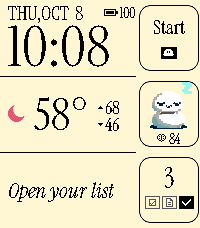
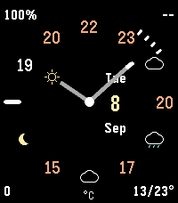
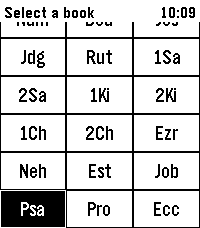
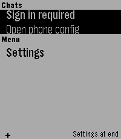
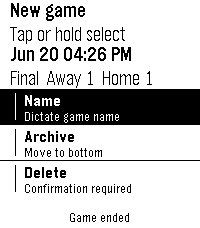

<!-- Generated by scripts/update_app_directory.py: do not edit by hand -->
[← All Pebble Developers](../developers.md)

# nick1udwig

*1 watchface and 4 apps · Last updated 2026-10-11 · [About these lists](../about-app-lists.md)*

Links: [Pebble App Store](https://apps.repebble.com/apps/dev/nick1udwig_d30aec49b29caa20180a2880) · [GitHub (nick1udwig)](https://github.com/nick1udwig)

<button type="button" data-filter="all" aria-pressed="true">All 5</button><button type="button" data-filter="watchface" aria-pressed="false">Watchfaces 1</button><button type="button" data-filter="watchapp" aria-pressed="false">Apps 4</button>

<label class="dev-sort">Sort by <select><option value="updated">Recently updated</option><option value="released">Newest release</option><option value="title">A–Z</option></select></label>

<h2 class="app-name" id="app-34c8e534967b4680980f3fdc"><a href="https://apps.repebble.com/34c8e534967b4680980f3fdc">codey</a> v0.2.2</h2>
<a class="app-source" href="https://github.com/nick1udwig/codey" title="Source code" data-search-exclude>View source</a>

App

Released 2026-09-15 Updated 2026-10-08

Runs on: Round 2, Time 2

codey is a personal assistant, powered by codex. Check your calendar, the weather, check off TODOs, or query/instruct your codex agent, all from your wrist. Run the codey-server on your Linux or…

<h2 class="app-name" id="app-ffdc822b40d24c16b4247eb4"><a href="https://apps.repebble.com/ffdc822b40d24c16b4247eb4">Crisp Weather</a> v0.1.0</h2>
<a class="app-source" href="https://github.com/nick1udwig/crisp-weather" title="Source code" data-search-exclude>View source</a>

Watchface

Released 2026-09-11 Updated 2026-09-11

Runs on: Round 2, Time 2, Pebble 2 Duo, Pebble 2, Time Round, Time, Classic

Built starting from the excellent Crisp watchface - Hour ticks are temperature or weather type, if there&#x27;s a change (e.g. sunny -&gt; cloudy displays a cloud) - The end of the hour hand displays the…

<h2 class="app-name" id="app-0cb8b674e98944d88fa3aa29"><a href="https://apps.repebble.com/0cb8b674e98944d88fa3aa29">Bibble</a> v0.5.0</h2>
<a class="app-source" href="https://github.com/nick1udwig/bibble" title="Source code" data-search-exclude>View source</a>

App

Released 2026-06-21 Updated 2026-09-11

Runs on: Round 2, Time 2

A Bible app for Pebble with modern features Hold Select to dictate a Book, Chapter, or Verse, e.g. &quot;Psalms 23&quot;. Or dictate a word or phrase, e.g. &quot;God so loved the world&quot; to jump to John 3:16

<h2 class="app-name" id="app-87f0ec7418924c2aa843a159"><a href="https://apps.repebble.com/87f0ec7418924c2aa843a159">tg</a> v0.2.0</h2>
<a class="app-source" href="https://github.com/nick1udwig/tg-pebble" title="Source code" data-search-exclude>View source</a>

App

Released 2026-04-16 Updated 2026-07-17

Runs on: Time 2, Pebble 2 Duo, Pebble 2, Time, Classic

Telegram interface for Pebble (unofficial). Read your messages and send with dictation. Message your friends -- or your OpenClaw -- all from your Pebble!

<h2 class="app-name" id="app-d1138c758eec41a8b0a7e42b"><a href="https://apps.repebble.com/d1138c758eec41a8b0a7e42b">Basebble</a> v0.1.0</h2>
<a class="app-source" href="https://github.com/nick1udwig/basebble" title="Source code" data-search-exclude>View source</a>

App

Released 2026-06-21 Updated 2026-06-21

Runs on: Round 2, Time 2

A simple baseball game score tracker for Pebble

