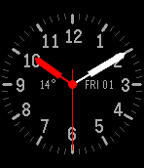

<!-- Generated by scripts/update_app_directory.py: do not edit by hand -->
[← All Pebble Developers](../developers.md)

# Nicko Guyer

*1 watchface · Last updated 2026-10-11 · [About these lists](../about-app-lists.md)*

Links: [Pebble App Store](https://apps.repebble.com/apps/dev/nicko-guyer_52f0ef2e61b752a5520029bc) · [GitHub (nguyer)](https://github.com/nguyer)

<h2 class="app-name" id="app-55ff2456ed80fc148d000099"><a href="https://apps.repebble.com/55ff2456ed80fc148d000099">Engineering</a> v1.6</h2>
<a class="app-source" href="https://github.com/nguyer/pebble-engineering" title="Source code" data-search-exclude>View source</a>

Watchface

Released 2015-09-20 Updated 2016-01-19

Runs on: Round 2, Time 2, Pebble 2 Duo, Pebble 2, Time Round, Time, Classic

A precise, simple, and customizable analog watchface. Includes second hand, current day, and date, as well as current temperature (determined by GPS location). All labels can be turned on or off…

