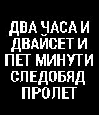

<!-- Generated by scripts/update_app_directory.py: do not edit by hand -->
[← All Pebble Developers](../developers.md)

# Nickola Trupcheff

*1 watchface · Last updated 2026-10-11 · [About these lists](../about-app-lists.md)*

Links: [Rebble App Store](https://apps.rebble.io/en_US/developer/54156ec1bcd1cf9264000131/1) · [GitHub (mapbuh)](https://github.com/mapbuh)

<h2 class="app-name" id="app-5419f6dc0193218b2f00021b"><a href="https://apps.rebble.io/en_US/application/5419f6dc0193218b2f00021b">Bulgarian clock / Часовник на български</a> v1.17</h2>
<a class="app-source" href="https://github.com/mapbuh/pebble-bg-clock" title="Source code" data-search-exclude>View source</a>

Watchface

Released 2014-09-17 Updated 2016-05-16 Rebble App Store

Runs on: Round 2, Time 2, Pebble 2 Duo, Pebble 2, Time Round, Time, Classic

The time and date in Bulgarian. Часът и датата с думи, и на български.

