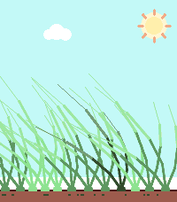

<!-- Generated by scripts/update_app_directory.py: do not edit by hand -->
[← All Pebble Developers](../developers.md)

# Nicolai Søborg

*1 app · Last updated 2026-10-11 · [About these lists](../about-app-lists.md)*

Links: [Pebble App Store](https://apps.repebble.com/apps/dev/nicolai-s-borg_11569eaac4fc23c1cd73bb0f)

<h2 class="app-name" id="app-a7de79b5e84b46f7a656a019"><a href="https://apps.repebble.com/a7de79b5e84b46f7a656a019">Touch Grass</a> v1.1.0</h2>
<a class="app-source" href="https://hg.sr.ht/~nicolai/touch-grass" title="Source code" data-search-exclude>View source</a>

App

Released 2026-07-21 Updated 2026-07-23

Runs on: Round 2, Time 2

Hello BornHack 2026 - this app allows you to touch grass

