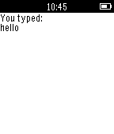
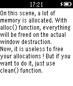

<!-- Generated by scripts/update_app_directory.py: do not edit by hand -->
[← All Pebble Developers](../developers.md)

# Nicolas VAREILLE

*2 apps · Last updated 2026-10-12 · [About these lists](../about-app-lists.md)*

Links: [Pebble App Store](https://apps.repebble.com/apps/dev/nicolas-vareille_53a5f18106f41c91f700001b) · [GitHub (nvareille)](https://github.com/nvareille)

<button type="button" data-filter="all" aria-pressed="true">All 2</button><button type="button" data-filter="watchface" aria-pressed="false" disabled>Watchfaces 0</button><button type="button" data-filter="watchapp" aria-pressed="false">Apps 2</button>

<label class="dev-sort">Sort by <select><option value="updated">Recently updated</option><option value="released">Newest release</option><option value="title">A–Z</option></select></label>

<h2 class="app-name" id="app-54c75f12c5de00257c0000bb"><a href="https://apps.repebble.com/54c75f12c5de00257c0000bb">Khelljyr Framework Example (Keyboard Scene)</a> v1.0</h2>
<a class="app-source" href="https://github.com/nvareille/KhelljyrExamples/tree/master/simple_keyboard_demo" title="Source code" data-search-exclude>View source</a>

App

Released 2015-01-27 Updated 2015-01-27

Runs on: Time 2, Pebble 2 Duo, Pebble 2, Time, Classic

This is an example made with Khelljyr Pebble Framework The topic of this example is the Keyboard scene feature. /!\This is a code example for pebble. Unless you are a developer, this application…

<h2 class="app-name" id="app-54b7e81f986a22be1a000072"><a href="https://apps.repebble.com/54b7e81f986a22be1a000072">Khelljyr Framework Example (garbage collector)</a> v1.0</h2>
<a class="app-source" href="https://github.com/nvareille/Khelljyr" title="Source code" data-search-exclude>View source</a>

App

Released 2015-01-15 Updated 2015-01-15

Runs on: Time 2, Pebble 2 Duo, Pebble 2, Time, Classic

This is an example made with Khelljyr Pebble Framework The topic of this example is the garbage collector feature. /!\This is a code example for pebble. Unless you are a developer, this…

