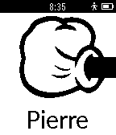

<!-- Generated by scripts/update_app_directory.py: do not edit by hand -->
[← All Pebble Developers](../developers.md)

# Nicoplv

*1 watchface and 1 app · Last updated 2026-10-12 · [About these lists](../about-app-lists.md)*

Links: [Pebble App Store](https://apps.repebble.com/apps/dev/nicoplv_542a54bff96784ad2a00004b) · [GitHub (nicoplv)](https://github.com/nicoplv)

<button type="button" data-filter="all" aria-pressed="true">All 2</button><button type="button" data-filter="watchface" aria-pressed="false">Watchfaces 1</button><button type="button" data-filter="watchapp" aria-pressed="false">Apps 1</button>

<label class="dev-sort">Sort by <select><option value="updated">Recently updated</option><option value="released">Newest release</option><option value="title">A–Z</option></select></label>

<h2 class="app-name" id="app-542d22099e034a9542000193"><a href="https://apps.repebble.com/542d22099e034a9542000193">Minimalist Text Watchface</a> v3.0</h2>
<a class="app-source" href="https://github.com/nicoplv/minimalist-text-watch" title="Source code" data-search-exclude>View source</a>

Watchface

Released 2014-10-02 Updated 2014-10-10

Runs on: Time 2, Pebble 2 Duo, Pebble 2, Time, Classic

A minimalist text watchface with time, date and battery display

<h2 class="app-name" id="app-5430e9adec1644f8b70000de"><a href="https://apps.repebble.com/5430e9adec1644f8b70000de">Shifumi</a> v1.0</h2>
<a class="app-source" href="https://github.com/nicoplv/shifumi-pebble" title="Source code" data-search-exclude>View source</a>

App

Released 2014-10-05 Updated 2014-10-05

Runs on: Time 2, Pebble 2 Duo, Pebble 2, Time, Classic

Simple shifumi game for pebble Use Up, Select and Down buttons to select your choice, and shake your wrist to show the selection to your opponent.

