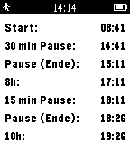

<!-- Generated by scripts/update_app_directory.py: do not edit by hand -->
[← All Pebble Developers](../developers.md)

# niesse

*1 app · Last updated 2026-10-12 · [About these lists](../about-app-lists.md)*

Links: [Pebble App Store](https://apps.repebble.com/apps/dev/niesse_5525791c0629e25fdf00004e) · [GitHub (njesse)](https://github.com/njesse)

<h2 class="app-name" id="app-552d0cb20835233ebf00000d"><a href="https://apps.repebble.com/552d0cb20835233ebf00000d">Time To Feierabend</a> v1.1</h2>
<a class="app-source" href="https://github.com/njesse/TimeToFeierabend" title="Source code" data-search-exclude>View source</a>

App

Released 2015-04-14 Updated 2017-08-11

Runs on: Time 2, Pebble 2 Duo, Pebble 2, Time, Classic

Deutsch: Die App zeigt die relevanten Uhrzeiten entsprechend dem deutschen Arbeitszeitgesetz an. Dazu gehören Arbeitsbeginn, Arbeitsende, eine 30 Minuten Pause nach 6h, eine 15 Minuten Pause nach…

