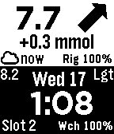

<!-- Generated by scripts/update_app_directory.py: do not edit by hand -->
[← All Pebble Developers](../developers.md)

# Nightscout contributors

*2 watchfaces · Last updated 2026-10-11 · [About these lists](../about-app-lists.md)*

Links: [Pebble App Store](https://apps.repebble.com/apps/dev/nightscout-contributors_53810824528fbe7c5f000187) · [GitHub (nightscout)](https://github.com/nightscout) · [Website (nightscout.github.io)](http://nightscout.github.io/)

<button type="button" data-filter="all" aria-pressed="true">All 2</button><button type="button" data-filter="watchface" aria-pressed="false">Watchfaces 2</button><button type="button" data-filter="watchapp" aria-pressed="false" disabled>Apps 0</button>

<label class="dev-sort">Sort by <select><option value="updated">Recently updated</option><option value="released">Newest release</option><option value="title">A–Z</option></select></label>

<h2 class="app-name" id="app-543bfcf6495b343315000227"><a href="https://apps.repebble.com/543bfcf6495b343315000227">Slot2 Nightscout</a> v7.4</h2>
<a class="app-source" href="https://github.com/nightscout/cgm-pebble" title="Source code" data-search-exclude>View source</a>

Watchface

Released 2014-10-13 Updated 2015-11-23

Runs on: Time 2, Pebble 2 Duo, Pebble 2, Time, Classic

Display Nightscout data on your pebble watch. Support for mg/dL and mmol units.

<h2 class="app-name" id="app-543bfbbcecc29baad0000007"><a href="https://apps.repebble.com/543bfbbcecc29baad0000007">Nightscout</a> v7.4</h2>
<a class="app-source" href="https://github.com/nightscout/cgm-pebble" title="Source code" data-search-exclude>View source</a>

Watchface

Released 2014-10-13 Updated 2015-11-23

Runs on: Time 2, Pebble 2 Duo, Pebble 2, Time, Classic

Display Nightscout data on your pebble watch. Support for mg/dL and mmol units.

