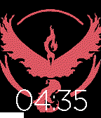

<!-- Generated by scripts/update_app_directory.py: do not edit by hand -->
[← All Pebble Developers](../developers.md)

# Nikhil Gumma

*1 watchface · Last updated 2026-10-12 · [About these lists](../about-app-lists.md)*

Links: [Pebble App Store](https://apps.repebble.com/apps/dev/nikhil-gumma_578d293584accca18800035d) · [GitHub (NikhilGumma)](https://github.com/NikhilGumma)

<h2 class="app-name" id="app-57968736a40d829e7b00000e"><a href="https://apps.repebble.com/57968736a40d829e7b00000e">Valor Watchface</a> v1.0</h2>
<a class="app-source" href="https://github.com/NikhilGumma/watchface_example_asl" title="Source code" data-search-exclude>View source</a>

Watchface

No licence Released 2016-07-25 Updated 2016-07-25

Runs on: Round 2, Time 2, Time Round, Time

Valor Logo from Pokemon Go with battery indicator

