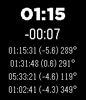

<!-- Generated by scripts/update_app_directory.py: do not edit by hand -->
[← All Pebble Developers](../developers.md)

# Nikita Komarov

*1 watchface · Last updated 2026-10-12 · [About these lists](../about-app-lists.md)*

Links: [Pebble App Store](https://apps.repebble.com/apps/dev/nikita-komarov_5470bbbb32fb2d8608000096) · [GitHub (winnukem)](https://github.com/winnukem)

<h2 class="app-name" id="app-55644a145818e0b381000044"><a href="https://apps.repebble.com/55644a145818e0b381000044">Iridium Flare Forecast</a> v0.2</h2>
<a class="app-source" href="https://github.com/winnukem/pebble-iridium" title="Source code" data-search-exclude>View source</a>

Watchface

Released 2015-05-26 Updated 2015-06-09

Runs on: Time 2, Pebble 2 Duo, Pebble 2, Time, Classic

Simple Iridium flare forecasting watchface, using data from heavens-above.com. Countdown starting 4 to 5 minutes before flare. Vibration alerts. Open source.

