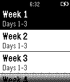

<!-- Generated by scripts/update_app_directory.py: do not edit by hand -->
[← All Pebble Developers](../developers.md)

# Nikita Pchelin

*1 app · Last updated 2026-10-12 · [About these lists](../about-app-lists.md)*

Links: [Pebble App Store](https://apps.repebble.com/apps/dev/nikita-pchelin_5361688475901be700000236) · [GitHub (jango)](https://github.com/jango) · [Website (pchelin.ca)](https://www.pchelin.ca)

<h2 class="app-name" id="app-53f32d22b62b051081000085"><a href="https://apps.repebble.com/53f32d22b62b051081000085">Running Coach</a> v1.0</h2>
<a class="app-source" href="https://github.com/jango/pebble_running" title="Source code" data-search-exclude>View source</a>

App

No licence Released 2014-08-19 Updated 2014-08-19

Runs on: Time 2, Pebble 2 Duo, Pebble 2, Time, Classic

A running app that provides users with timers for each workout of the C25K and B210K running programs. A buzz will alert you about the end of a running or walking interval and you will also be…

