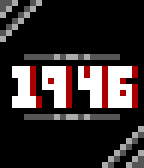
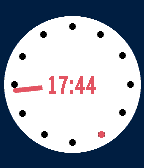
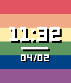

<!-- Generated by scripts/update_app_directory.py: do not edit by hand -->
[← All Pebble Developers](../developers.md)

# Nikki

*6 watchfaces and 1 app · Last updated 2026-10-11 · [About these lists](../about-app-lists.md)*

Links: [Rebble App Store](https://apps.rebble.io/en_US/developer/6050f9b61342ae00755aeb46/1) · [GitHub (not-phoeniix)](https://github.com/not-phoeniix)

<button type="button" data-filter="all" aria-pressed="true">All 7</button><button type="button" data-filter="watchface" aria-pressed="false">Watchfaces 6</button><button type="button" data-filter="watchapp" aria-pressed="false">Apps 1</button>

<label class="dev-sort">Sort by <select><option value="updated">Recently updated</option><option value="released">Newest release</option><option value="title">A–Z</option></select></label>

<h2 class="app-name" id="app-67cbd46ed2acb301fae26e30"><a href="https://apps.rebble.io/en_US/application/67cbd46ed2acb301fae26e30">Plurble</a> v0.6.1</h2>
<a class="app-source" href="https://github.com/not-phoeniix/plurble" title="Source code" data-search-exclude>View source</a>

App · <a href="https://forum.rebble.io/t/285" title="Discuss this app on the Rebble forum" data-search-exclude>Forum thread</a>

Released 2025-03-08 Updated 2026-08-14 Rebble App Store

Runs on: Round 2, Time 2, Pebble 2 Duo, Pebble 2, Time Round, Time

A plural management app on your wrist! Plurble is an app designed to help people who are plural/systems manage and keep track of members on the go! This was an app originally made for the Rebble…

<h2 class="app-name" id="app-637ad305fdf3e30009f639a7"><a href="https://apps.rebble.io/en_US/application/637ad305fdf3e30009f639a7">Pixel</a> v2.0</h2>
<a class="app-source" href="https://github.com/not-phoeniix/pixel" title="Source code" data-search-exclude>View source</a>

Watchface

Released 2022-11-21 Updated 2023-01-22 Rebble App Store

Runs on: Round 2, Time 2, Pebble 2 Duo, Pebble 2, Time Round, Time, Classic

Pixelated watchface for the Rebble Hackathon #001! Features: - Several background options - Several middle bar options - Full color customization (fg, bg, shadow, and 2 accents!) - Pride background :)

<h2 class="app-name" id="app-62479f8931bc3600098fec28"><a href="https://apps.rebble.io/en_US/application/62479f8931bc3600098fec28">Dots</a> v1.1</h2>
<a class="app-source" href="https://github.com/not-phoeniix/dots" title="Source code" data-search-exclude>View source</a>

Watchface

Released 2022-04-02 Updated 2022-09-15 Rebble App Store

Runs on: Round 2, Time 2, Pebble 2 Duo, Pebble 2, Time Round, Time, Classic

A watchface with dots! Features: Customizable colors, variable number of dots, and an optional pride flag!

<h2 class="app-name" id="app-60803d141342ae009528070f"><a href="https://apps.rebble.io/en_US/application/60803d141342ae009528070f">TicToc+</a> v1.3</h2>
<a class="app-source" href="https://github.com/not-phoeniix/tictoc_plus/" title="Source code" data-search-exclude>View source</a>

Watchface

Released 2021-04-21 Updated 2022-03-28 Rebble App Store

Runs on: Round 2, Time 2, Pebble 2 Duo, Pebble 2, Time Round, Time, Classic

An extension of the default Pebble Time watchface TicToc, with more features and customization Features: - Almost everything is toggleable! Don&#x27;t like the date? Turn it off! - BT disconnect vibe …

<h2 class="app-name" id="app-6188242ac82670000a67ad54"><a href="https://apps.rebble.io/en_US/application/6188242ac82670000a67ad54">Slash</a> v1.1</h2>
<a class="app-source" href="https://github.com/not-phoeniix/slash" title="Source code" data-search-exclude>View source</a>

Watchface

Released 2021-11-07 Updated 2022-03-28 Rebble App Store

Runs on: Round 2, Time 2, Pebble 2 Duo, Pebble 2, Time Round, Time, Classic

The time with a slash through it and a ring around it too. - Customizable time, accent, and background colors - Toggleable date animation - Pride flag ring :)

<h2 class="app-name" id="app-6050f9b61342ae00755aeb47"><a href="https://apps.rebble.io/en_US/application/6050f9b61342ae00755aeb47">Pride Time</a> v1.4</h2>
<a class="app-source" href="https://github.com/not-phoeniix/pride-time" title="Source code" data-search-exclude>View source</a>

Watchface

Released 2021-03-16 Updated 2022-03-28 Rebble App Store

Runs on: Round 2, Time 2, Time Round, Time

An LGBTQ+ pride watchface that has a bunch of different flags and a handful of customization options! Show off your pride :) - 16 different flags!! - custom background color (no flag) - custom…

<h2 class="app-name" id="app-60ba1ac61342ae021731a3e0"><a href="https://apps.rebble.io/en_US/application/60ba1ac61342ae021731a3e0">Metro+</a> v1.3</h2>
<a class="app-source" href="https://github.com/not-phoeniix/metro-plus" title="Source code" data-search-exclude>View source</a>

Watchface

Released 2021-06-04 Updated 2022-03-28 Rebble App Store

Runs on: Round 2, Time 2, Pebble 2 Duo, Pebble 2, Time Round, Time, Classic

Extension of other metro watchfaces on the Pebble store with features like: - customizable colors - animated date - pride flag background :) Heavily inspired by Metro Flip by AngerDanger

