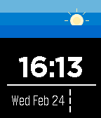

<!-- Generated by scripts/update_app_directory.py: do not edit by hand -->
[← All Pebble Developers](../developers.md)

# Nikolai Rinas

*1 watchface · Last updated 2026-10-11 · [About these lists](../about-app-lists.md)*

Links: [Pebble App Store](https://apps.repebble.com/apps/dev/nikolai-rinas_56ab240fd025c2abc5000015) · [GitHub (workinghard)](https://github.com/workinghard)

<h2 class="app-name" id="app-56f9fa043c131b30f1000029"><a href="https://apps.repebble.com/56f9fa043c131b30f1000029">DigiMe</a> v1.7</h2>
<a class="app-source" href="https://github.com/workinghard/DigiMe" title="Source code" data-search-exclude>View source</a>

Watchface

Released 2016-03-29 Updated 2025-11-25

Runs on: Round 2, Time 2, Pebble 2 Duo, Pebble 2, Time Round, Time, Classic

Just a simple and fast watch face. Sun and moon will follow you through the day. Temperature is based on current location and http://openweathermap.org data. Small bars indicates the battery…

