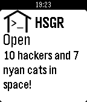

<!-- Generated by scripts/update_app_directory.py: do not edit by hand -->
[← All Pebble Developers](../developers.md)

# Nikos Roussos

*1 app · Last updated 2026-10-11 · [About these lists](../about-app-lists.md)*

Links: [Pebble App Store](https://apps.repebble.com/apps/dev/nikos-roussos_566b478844cb3cf34f000064) · [GitHub (hsgr)](https://github.com/hsgr) · [Website (hackerspace.gr)](https://www.hackerspace.gr/)

<h2 class="app-name" id="app-5672ef77fa6d41958400001f"><a href="https://apps.repebble.com/5672ef77fa6d41958400001f">Hackerspace.gr</a> v0.2</h2>
<a class="app-source" href="https://github.com/hsgr/hsgr-pebble" title="Source code" data-search-exclude>View source</a>

App

Released 2015-12-17 Updated 2016-06-14

Runs on: Time 2, Pebble 2 Duo, Pebble 2, Time, Classic

Simple app to view Hackerspace.gr status

