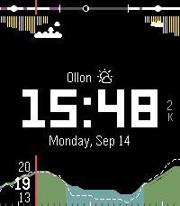

<!-- Generated by scripts/update_app_directory.py: do not edit by hand -->
[← All Pebble Developers](../developers.md)

# Nils Reichhard

*1 watchface · Last updated 2026-11-02 · [About these lists](../about-app-lists.md)*

Links: [Pebble App Store](https://apps.repebble.com/apps/dev/nils-reichhard_4ec083c4ed06a2ef058e98ab) · [GitHub (nilsreichhard)](https://github.com/nilsreichhard)

<h2 class="app-name" id="app-a93e14bc57624e368e156ab6"><a href="https://apps.repebble.com/a93e14bc57624e368e156ab6">Carbon Ion</a> v3.2.0</h2>
<a class="app-source" href="https://github.com/nilsreichhard/carbon-ion" title="Source code" data-search-exclude>View source</a>

Watchface

GPL-3.0 Released 2026-09-09 Updated 2026-10-23

Runs on: Round 2, Time 2

Short summary: A precise weather timeline watchface with temperature, rain, clouds, daylight, calendar and battery on one rolling track. Feedback is welcomed. Carbon Ion Carbon Ion turns your…

