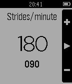

<!-- Generated by scripts/update_app_directory.py: do not edit by hand -->
[← All Pebble Developers](../developers.md)

# Ninjacat

*1 app · Last updated 2026-10-11 · [About these lists](../about-app-lists.md)*

Links: [Pebble App Store](https://apps.repebble.com/apps/dev/ninjacat_52f162f9c41172b4470005bd) · [GitHub (uaraven)](https://github.com/uaraven)

<h2 class="app-name" id="app-551c91e57a1b581177000025"><a href="https://apps.repebble.com/551c91e57a1b581177000025">PaceKeeper</a> v1.0</h2>
<a class="app-source" href="https://github.com/uaraven/pacekeeper" title="Source code" data-search-exclude>View source</a>

App

Released 2015-04-02 Updated 2015-04-07

Runs on: Time 2, Pebble 2 Duo, Pebble 2, Time, Classic

Whatchapp to help you keep your running cadence. It will vibrate your watch to keep your rhythm. Up and down buttons to set strides per minute. Select button to start/stop rhythm. Long press on…

