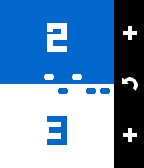

<!-- Generated by scripts/update_app_directory.py: do not edit by hand -->
[← All Pebble Developers](../developers.md)

# nippysaurus

*1 app · Last updated 2026-10-12 · [About these lists](../about-app-lists.md)*

Links: [Pebble App Store](https://apps.repebble.com/apps/dev/nippysaurus_5793533150c752b5c9000242) · [GitHub (nippysaurus)](https://github.com/nippysaurus)

<h2 class="app-name" id="app-57c180145e3c3ddfb8000236"><a href="https://apps.repebble.com/57c180145e3c3ddfb8000236">Table Tennis</a> v1.2</h2>
<a class="app-source" href="https://github.com/nippysaurus/table_tennis" title="Source code" data-search-exclude>View source</a>

App

Released 2016-08-27 Updated 2016-10-03

Runs on: Round 2, Time 2, Pebble 2 Duo, Pebble 2, Time Round, Time, Classic

Track your table tennis scoring during play. Features: - Play to 11 or 21. - Overtime serving rules (when game reaches 10:10 or 20:20). - Choose vibration options for player serve, serve change…

