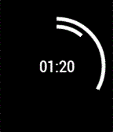
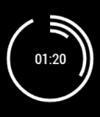

<!-- Generated by scripts/update_app_directory.py: do not edit by hand -->
[← All Pebble Developers](../developers.md)

# Niraj Sanghvi

*2 watchfaces · Last updated 2026-10-11 · [About these lists](../about-app-lists.md)*

Links: [Pebble App Store](https://apps.repebble.com/apps/dev/niraj-sanghvi_52cfa400f726c8a19f00003d) · [GitHub (op12)](https://github.com/op12)

<button type="button" data-filter="all" aria-pressed="true">All 2</button><button type="button" data-filter="watchface" aria-pressed="false">Watchfaces 2</button><button type="button" data-filter="watchapp" aria-pressed="false" disabled>Apps 0</button>

<label class="dev-sort">Sort by <select><option value="updated">Recently updated</option><option value="released">Newest release</option><option value="title">A–Z</option></select></label>

<h2 class="app-name" id="app-52cfa8e44680afff3300004e"><a href="https://apps.repebble.com/52cfa8e44680afff3300004e">Polar Clock Lite 2.0</a> v2.1.1</h2>
<a class="app-source" href="https://github.com/op12/PolarClockLite2.0" title="Source code" data-search-exclude>View source</a>

Watchface

Released 2014-01-10 Updated 2014-01-15

Runs on: Time 2, Pebble 2 Duo, Pebble 2, Time, Classic

A polar clock that displays the time using rings to represent the hour and minute with optional digital time and date display (see Polar Clock for the version of this with animated seconds..this…

<h2 class="app-name" id="app-52cfa6a14680afc56f00004b"><a href="https://apps.repebble.com/52cfa6a14680afc56f00004b">Polar Clock 2.0</a> v2.1.1</h2>
<a class="app-source" href="https://github.com/op12/PolarClock2.0" title="Source code" data-search-exclude>View source</a>

Watchface

Released 2014-01-10 Updated 2014-01-15

Runs on: Time 2, Pebble 2 Duo, Pebble 2, Time, Classic

A polar clock that displays the time using rings to represent the hour, minute, and second with optional digital time and date display (for less battery drain/animation, use Polar Clock Lite which…

