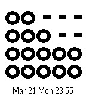

<!-- Generated by scripts/update_app_directory.py: do not edit by hand -->
[← All Pebble Developers](../developers.md)

# niss

*1 watchface · Last updated 2026-10-12 · [About these lists](../about-app-lists.md)*

Links: [Pebble App Store](https://apps.repebble.com/apps/dev/niss_52cb82a4e2dd027fe50000e5) · [GitHub (KimSeungKyu)](https://github.com/KimSeungKyu) · [Website (nisscube.blogspot.kr)](http://nisscube.blogspot.kr/2014/03/morse-code-clock.html)

<h2 class="app-name" id="app-53136626bb31cf87cd0002e5"><a href="https://apps.repebble.com/53136626bb31cf87cd0002e5">Morse Code Clock</a> v1.2</h2>
<a class="app-source" href="https://github.com/KimSeungKyu/MorseCodeClock" title="Source code" data-search-exclude>View source</a>

Watchface

No licence Released 2014-03-02 Updated 2025-11-25

Runs on: Time 2, Pebble 2 Duo, Pebble 2, Time, Classic

This is morse code viberate clock. If you want to know now time to shake your pebble.

