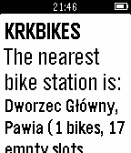

<!-- Generated by scripts/update_app_directory.py: do not edit by hand -->
[← All Pebble Developers](../developers.md)

# njet

*1 app · Last updated 2026-10-11 · [About these lists](../about-app-lists.md)*

Links: [Pebble App Store](https://apps.repebble.com/apps/dev/njet_55c74f126b4abe7ff6000076) · [GitHub (tenpawelnowak)](https://github.com/tenpawelnowak)

<h2 class="app-name" id="app-55d44bf939cb5c7ee7000077"><a href="https://apps.repebble.com/55d44bf939cb5c7ee7000077">KRKBIKES</a> v1.0</h2>
<a class="app-source" href="https://github.com/tenpawelnowak/KRKBIKES-for-Pebble" title="Source code" data-search-exclude>View source</a>

App

Released 2015-08-19 Updated 2015-08-19

Runs on: Time 2, Pebble 2 Duo, Pebble 2, Time, Classic

KRKBIKES displays the nearest city bike station in Cracow, Poland.

