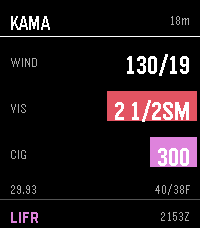

<!-- Generated by scripts/update_app_directory.py: do not edit by hand -->
[← All Pebble Developers](../developers.md)

# Noah

*1 app · Last updated 2026-11-16 · [About these lists](../about-app-lists.md)*

Links: [Pebble App Store](https://apps.repebble.com/apps/dev/noah_83c1a2ea121d12a3d2918889) · [GitHub (thesubtlety)](https://github.com/thesubtlety)

<h2 class="app-name" id="app-9a76e02fefca415aa7164907"><a href="https://apps.repebble.com/9a76e02fefca415aa7164907">Airport Wx</a> v1.0.0</h2>
<a class="app-source" href="https://github.com/thesubtlety/pebble-aviation-wx" title="Source code" data-search-exclude>View source</a>

App

No licence Released 2026-11-15 Updated 2026-11-15

Runs on: Time 2

Airport Wx shows the latest METAR and TAF for your airports on a Pebble Time 2. PAGES Home: Wind, visibility, ceiling, altimeter setting, temperature and dew point. The header shows the age of the…

