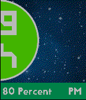
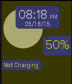

<!-- Generated by scripts/update_app_directory.py: do not edit by hand -->
[← All Pebble Developers](../developers.md)

# Noah Hanover

*2 watchfaces · Last updated 2026-10-11 · [About these lists](../about-app-lists.md)*

Links: [Pebble App Store](https://apps.repebble.com/apps/dev/noah-hanover_54ef90192365a40c370000b5)

<button type="button" data-filter="all" aria-pressed="true">All 2</button><button type="button" data-filter="watchface" aria-pressed="false">Watchfaces 2</button><button type="button" data-filter="watchapp" aria-pressed="false" disabled>Apps 0</button>

<label class="dev-sort">Sort by <select><option value="updated">Recently updated</option><option value="released">Newest release</option><option value="title">A–Z</option></select></label>

<h2 class="app-name" id="app-555be32a4231f4ddf300004a"><a href="https://apps.repebble.com/555be32a4231f4ddf300004a">The Corcle Face</a> v1.0</h2>
<a class="app-source" href="https://bitbucket.org/nhano0228/circle_colors" title="Source code" data-search-exclude>View source</a>

Watchface

Released 2015-05-20 Updated 2015-05-20

Runs on: Time 2, Time

This app shows you the time with beautiful animations and a breathtaking starry night. How could you not wonder what is the beyond without looking at this watchface?

<h2 class="app-name" id="app-555951ac9b0538e82b000066"><a href="https://apps.repebble.com/555951ac9b0538e82b000066">Sun and Moon Rise</a> v1.0</h2>
<a class="app-source" href="https://bitbucket.org/nhano0228/sunrise-watchface" title="Source code" data-search-exclude>View source</a>

Watchface

Released 2015-05-18 Updated 2015-05-18

Runs on: Time 2, Time

This watchface shows the time, date, battery percent, and shows the moon and sun rise/set. It changes based on the time of day, and every 6 hours, it sets again. It also changes the background…

