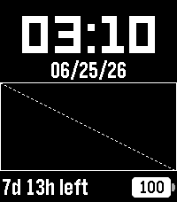

<!-- Generated by scripts/update_app_directory.py: do not edit by hand -->
[← All Pebble Developers](../developers.md)

# Noah Kiser

*5 watchfaces · Last updated 2026-10-12 · [About these lists](../about-app-lists.md)*

Links: [Pebble App Store](https://apps.repebble.com/apps/dev/noah-kiser_309e95d94e23b9be8fa889d9) · [GitHub (KiserDesigns)](https://github.com/KiserDesigns) · [Website (forum.repebble.com)](https://forum.repebble.com/t/rombra-roman-umbra/537)

<button type="button" data-filter="all" aria-pressed="true">All 5</button><button type="button" data-filter="watchface" aria-pressed="false">Watchfaces 5</button><button type="button" data-filter="watchapp" aria-pressed="false" disabled>Apps 0</button>

<label class="dev-sort">Sort by <select><option value="updated">Recently updated</option><option value="released">Newest release</option><option value="title">A–Z</option></select></label>

<h2 class="app-name" id="app-6797522d3d3a4b93ad1526bd"><a href="https://apps.repebble.com/6797522d3d3a4b93ad1526bd">Fresco</a> v0.2.6</h2>
<a class="app-source" href="https://github.com/KiserDesigns/Pebble_Fresco" title="Source code" data-search-exclude>View source</a>

Watchface

No licence Released 2026-07-08 Updated 2026-08-13

Runs on: Round 2, Time 2, Pebble 2 Duo, Pebble 2, Time Round, Time, Classic

Settings Tests

<h2 class="app-name" id="app-1565d65a737b4d3591cff3b4"><a href="https://apps.repebble.com/1565d65a737b4d3591cff3b4">BattMan</a> v1.4.4</h2>
<a class="app-source" href="https://github.com/KiserDesigns/Pebble_BattMan" title="Source code" data-search-exclude>View source</a>

Watchface

No licence Released 2026-05-29 Updated 2026-07-07

Runs on: Round 2, Time 2, Pebble 2 Duo, Pebble 2, Time Round, Time, Classic

Simple Watchface that predicts battery life and charge time. Weather from Open-Meteo. Charge and Discharge rate estimates are saved to persistent storage, and are re-calculated based on actual…

<h2 class="app-name" id="app-680f5c9070e24f878e237b78"><a href="https://apps.repebble.com/680f5c9070e24f878e237b78">Rombra</a> v2.2.0</h2>
<a class="app-source" href="https://github.com/KiserDesigns/Pebble_RomanShadow" title="Source code" data-search-exclude>View source</a>

Watchface · <a href="https://forum.rebble.io/t/1126" title="Discuss this app on the Rebble forum" data-search-exclude>Forum thread</a>

No licence Released 2026-04-17 Updated 2026-07-06

Runs on: Round 2, Time 2, Pebble 2 Duo, Pebble 2, Time Round, Time, Classic

Roman Umbra, where sundial meets clockface. The umbra (shadow) direction is the minute, with Roman numerals for the hour. Colors of the numeral (hour), umbra (minute), and background are fully…

<h2 class="app-name" id="app-7d1fc3f9a61d4646b406429b"><a href="https://apps.repebble.com/7d1fc3f9a61d4646b406429b">Sweeep</a> v1.0.2</h2>
<a class="app-source" href="https://github.com/KiserDesigns/Pebble_Sweeep" title="Source code" data-search-exclude>View source</a>

Watchface

No licence Released 2026-05-14 Updated 2026-05-14

Runs on: Round 2, Time 2, Pebble 2 Duo, Pebble 2, Time Round, Time, Classic

Hand shows hour, arc shows minutes. For the first half hour, the arc fills up, starting at the tip of the hand and going clockwise. At half-past, the arc is a full circle. For the last half of the…

<h2 class="app-name" id="app-50bdea7ee3ff48308157c046"><a href="https://apps.repebble.com/50bdea7ee3ff48308157c046">JustTheTime</a> v1.2</h2>
<a class="app-source" href="https://github.com/KiserDesigns/Pebble_JustTheTime" title="Source code" data-search-exclude>View source</a>

Watchface

No licence Released 2026-04-07 Updated 2026-04-08

Runs on: Round 2, Time 2, Pebble 2 Duo, Pebble 2, Time Round, Time, Classic

An analog clock with day-of-month window and battery meter arc. Colors and sizes of all elements are configurable.

