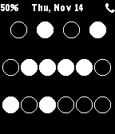

<!-- Generated by scripts/update_app_directory.py: do not edit by hand -->
[← All Pebble Developers](../developers.md)

# Noah Martin

*1 watchface · Last updated 2026-10-11 · [About these lists](../about-app-lists.md)*

Links: [Pebble App Store](https://apps.repebble.com/apps/dev/noah-martin_52b20d26b70e1ca84c000057) · [GitHub (noahsmartin)](https://github.com/noahsmartin)

<h2 class="app-name" id="app-52cb738845ffdd8ad50000cd"><a href="https://apps.repebble.com/52cb738845ffdd8ad50000cd">Binary</a> v1.0.0</h2>
<a class="app-source" href="https://github.com/noahsmartin/BinaryPebble" title="Source code" data-search-exclude>View source</a>

Watchface

Released 2014-01-07 Updated 2014-01-07

Runs on: Time 2, Pebble 2 Duo, Pebble 2, Time, Classic

A simple binary watchface for pebble. The first row is hours, middle is minutes, and bottom is seconds. The status bar shows battery status and the watch will vibrate if you leave your phone behind.

