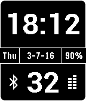
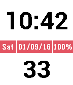

<!-- Generated by scripts/update_app_directory.py: do not edit by hand -->
[← All Pebble Developers](../developers.md)

# Noah Scarbrough

*2 watchfaces · Last updated 2026-10-12 · [About these lists](../about-app-lists.md)*

Links: [Pebble App Store](https://apps.repebble.com/apps/dev/noah-scarbrough_567d73cfa2dee26dc00001a2)

<button type="button" data-filter="all" aria-pressed="true">All 2</button><button type="button" data-filter="watchface" aria-pressed="false">Watchfaces 2</button><button type="button" data-filter="watchapp" aria-pressed="false" disabled>Apps 0</button>

<label class="dev-sort">Sort by <select><option value="updated">Recently updated</option><option value="released">Newest release</option><option value="title">A–Z</option></select></label>

<h2 class="app-name" id="app-56bdf7a0c85a7ebc54000011"><a href="https://apps.repebble.com/56bdf7a0c85a7ebc54000011">Info Bar Onyx</a> v1.1</h2>
<a class="app-source" href="https://www.dropbox.com/s/cd6bqim7cwx8nfc/Info%20Bar%20Onyx%201.1%20source.zip?dl=0" title="Source code" data-search-exclude>View source</a>

Watchface

Released 2016-02-12 Updated 2016-03-09

Runs on: Round 2, Time 2, Pebble 2 Duo, Pebble 2, Time Round, Time, Classic

Better than the original in every way. More sleek, more readable, and more functional. Displays - Time - Seconds - AM/PM (hidden in 24h mode) - Date - Day of the week - Battery percentage …

<h2 class="app-name" id="app-568309b2a7c9201e9e00006d"><a href="https://apps.repebble.com/568309b2a7c9201e9e00006d">Info Bar</a> v1.3</h2>
<a class="app-source" href="https://www.dropbox.com/s/o4v243yrifqd88d/Info%20Bar%201.3%20source.zip?dl=0" title="Source code" data-search-exclude>View source</a>

Watchface

Released 2015-12-29 Updated 2016-01-12

Runs on: Round 2, Time 2, Pebble 2 Duo, Pebble 2, Time Round, Time, Classic

Info Bar is a basic digital watchface, but with a unique twist. A unified bar of important information spans across the middle of the watch. This is a useful design for looking at more than just…

