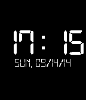

<!-- Generated by scripts/update_app_directory.py: do not edit by hand -->
[← All Pebble Developers](../developers.md)

# Noah

*1 watchface · Last updated 2026-10-12 · [About these lists](../about-app-lists.md)*

Links: [Pebble App Store](https://apps.repebble.com/apps/dev/noah_5361452920d31c440e00020b) · [GitHub (noah95)](https://github.com/noah95)

<h2 class="app-name" id="app-5415b1c4df02a24e5f00015b"><a href="https://apps.repebble.com/5415b1c4df02a24e5f00015b">Digital Live</a> v1.0</h2>
<a class="app-source" href="https://github.com/noah95/DigitalLive" title="Source code" data-search-exclude>View source</a>

Watchface

Released 2014-09-14 Updated 2014-09-14

Runs on: Time 2, Pebble 2 Duo, Pebble 2, Time, Classic

A simple, digital, retro and energy saving watchface for your pebble.

