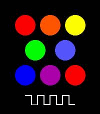

<!-- Generated by scripts/update_app_directory.py: do not edit by hand -->
[← All Pebble Developers](../developers.md)

# Nochi Shikarunochi

*1 app · Last updated 2026-10-11 · [About these lists](../about-app-lists.md)*

Links: [Pebble App Store](https://apps.repebble.com/apps/dev/nochi-shikarunochi_3ecb25cb217534d4bbc7e9c2) · [GitHub (shikarunochi)](https://github.com/shikarunochi)

<h2 class="app-name" id="app-e274ceede0b440fd8045ad7b"><a href="https://apps.repebble.com/e274ceede0b440fd8045ad7b">PEBBLE-TONE</a> v1.7</h2>
<a class="app-source" href="https://github.com/shikarunochi/PebbleTone" title="Source code" data-search-exclude>View source</a>

App

Released 2026-05-02 Updated 2026-05-03

Runs on: Time 2

A simple piano app for Pebble Time 2. You can play one octave of notes.

