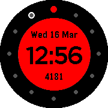

<!-- Generated by scripts/update_app_directory.py: do not edit by hand -->
[← All Pebble Developers](../developers.md)

# nodu

*1 watchface · Last updated 2026-10-12 · [About these lists](../about-app-lists.md)*

Links: [Pebble App Store](https://apps.repebble.com/apps/dev/nodu_531be62ac5f2c58d3f000a27) · [GitHub (nodu)](https://github.com/nodu)

<h2 class="app-name" id="app-56e8e85d6214185de8000038"><a href="https://apps.repebble.com/56e8e85d6214185de8000038">Revolver+</a> v1.0</h2>
<a class="app-source" href="https://github.com/nodu/pebbleFaceR" title="Source code" data-search-exclude>View source</a>

Watchface

Released 2016-03-16 Updated 2016-03-16

Runs on: Round 2, Time Round

Pebble Time Round Only (for now!) Upgraded version of Pebble&#x27;s Revolver watchface. -Removed animations and screen updates for better battery savings. -Added step tracker that refreshes every…

