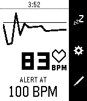
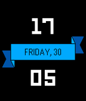
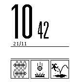

<!-- Generated by scripts/update_app_directory.py: do not edit by hand -->
[← All Pebble Developers](../developers.md)

# Noiob

*2 watchfaces and 1 app · Last updated 2026-10-11 · [About these lists](../about-app-lists.md)*

Links: [Rebble App Store](https://apps.rebble.io/en_US/developer/57743b6bba2fe5d0c60004ad/1) · [Pebble App Store](https://apps.repebble.com/apps/dev/noiob_57743b6bba2fe5d0c60004ad) · [GitHub (noiob)](https://github.com/noiob) · [Website (twitter.com)](https://twitter.com/n0i0b)

<button type="button" data-filter="all" aria-pressed="true">All 3</button><button type="button" data-filter="watchface" aria-pressed="false">Watchfaces 2</button><button type="button" data-filter="watchapp" aria-pressed="false">Apps 1</button>

<label class="dev-sort">Sort by <select><option value="updated">Recently updated</option><option value="released">Newest release</option><option value="title">A–Z</option></select></label>

<h2 class="app-name" id="app-586a9a9fe09e637c8c0003a7"><a href="https://apps.rebble.io/en_US/application/586a9a9fe09e637c8c0003a7">Pulse Alert</a> v2.4</h2>
<a class="app-source" href="https://github.com/noiob/pulse-alert" title="Source code" data-search-exclude>View source</a>

App

Released 2017-01-02 Updated 2017-03-02 Rebble App Store

Runs on: Time 2, Pebble 2 Duo, Pebble 2

Need to watch your heart rate? This is the app for you! Pulse Alert runs in the background and notifies you if Pebble Health detects a heart rate higher than your set value. You can set the…

<h2 class="app-name" id="app-57ee7ab205e4b10205000094"><a href="https://apps.repebble.com/57ee7ab205e4b10205000094">Square Banner</a> v1.3</h2>
<a class="app-source" href="https://github.com/noiob/squarebanner" title="Source code" data-search-exclude>View source</a>

Watchface

Released 2016-09-30 Updated 2016-11-29

Runs on: Time 2, Pebble 2 Duo, Pebble 2, Time, Classic

An attempt at creating a square version of Banner (https://apps.getpebble.com/en_US/application/560c2671d96cadb52600007f). Functionality: - Vibrate on Bluetooth Disconnect (respecting quiet time!)

<h2 class="app-name" id="app-5832c17200355a8634000185"><a href="https://apps.repebble.com/5832c17200355a8634000185">Portal Sign +💟</a> v1.2</h2>
<a class="app-source" href="https://github.com/noiob/portal_watchface" title="Source code" data-search-exclude>View source</a>

Watchface

Released 2016-11-21 Updated 2016-11-21

Runs on: Time 2, Pebble 2 Duo, Pebble 2, Time

[portal sign plus health] Original can be found at https://apps.getpebble.com/en_US/application/556382a65c83e51dbb000091 A version of degygii&#x27;s Portal themed Watchface, which is made to look like…

