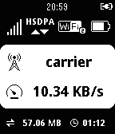

<!-- Generated by scripts/update_app_directory.py: do not edit by hand -->
[← All Pebble Developers](../developers.md)

# noondaymoon

*1 watchface and 1 app · Last updated 2026-10-11 · [About these lists](../about-app-lists.md)*

Links: [Pebble App Store](https://apps.repebble.com/apps/dev/noondaymoon_52edfc75ffcd25e2ca000001) · [GitHub (noondaymoon)](https://github.com/noondaymoon)

<button type="button" data-filter="all" aria-pressed="true">All 2</button><button type="button" data-filter="watchface" aria-pressed="false">Watchfaces 1</button><button type="button" data-filter="watchapp" aria-pressed="false">Apps 1</button>

<label class="dev-sort">Sort by <select><option value="updated">Recently updated</option><option value="released">Newest release</option><option value="title">A–Z</option></select></label>

<h2 class="app-name" id="app-543e6f8f6fbfc12dcd00009c"><a href="https://apps.repebble.com/543e6f8f6fbfc12dcd00009c">wifi status</a> v2.1</h2>
<a class="app-source" href="https://github.com/noondaymoon/e585" title="Source code" data-search-exclude>View source</a>

App

Released 2014-10-15 Updated 2016-10-17

Runs on: Round 2, Time 2, Pebble 2 Duo, Pebble 2, Time Round, Time, Classic

display mobile rooter status for huawei e585 (myfi) and hw-01c, gl10p it can display: ・signal level ・network type ・connecting device number ・battery level ・carrier name ・current transfer speed…

<h2 class="app-name" id="app-5357a79853dfbf163300004d"><a href="https://apps.repebble.com/5357a79853dfbf163300004d">noondaymoon</a> v2.2</h2>
<a class="app-source" href="https://github.com/noondaymoon/watchface" title="Source code" data-search-exclude>View source</a>

Watchface

Released 2014-04-23 Updated 2015-11-08

Runs on: Round 2, Time 2, Pebble 2 Duo, Pebble 2, Time Round, Time, Classic

It&#x27;s simple watchface. displays time, date, battery, and bluetooth.

