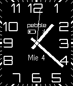

<!-- Generated by scripts/update_app_directory.py: do not edit by hand -->
[← All Pebble Developers](../developers.md)

# Nosagadu

*1 watchface · Last updated 2026-10-12 · [About these lists](../about-app-lists.md)*

Links: [Pebble App Store](https://apps.repebble.com/apps/dev/nosagadu_52a999a7c0ca934b0e000069)

<h2 class="app-name" id="app-52a9a27679c18f04c000005b"><a href="https://apps.repebble.com/52a9a27679c18f04c000005b">Moderno Analogo</a> v1.0.0</h2>
<a class="app-source" href="https://www.dropbox.com/sh/spdq0jw6ypw2z0l/ulfOmBnQkp" title="Source code" data-search-exclude>View source</a>

Watchface

Released 2013-12-12 Updated 2013-12-12

Runs on: Time 2, Pebble 2 Duo, Pebble 2, Time, Classic

Watchface basado en Modern Extra pero en Español. - Despliega el estado de la conexión Bluetooth. - Se visualiza el estado de la batería del Pebble. - Indica cuando se esta cargando. - Cuando la…

