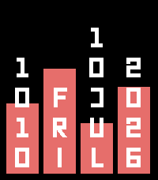

<!-- Generated by scripts/update_app_directory.py: do not edit by hand -->
[← All Pebble Developers](../developers.md)

# notnotrishi

*2 watchfaces · Last updated 2026-10-11 · [About these lists](../about-app-lists.md)*

Links: [Pebble App Store](https://apps.repebble.com/apps/dev/notnotrishi_0448c3eef71293ee4cf35ca7)

<button type="button" data-filter="all" aria-pressed="true">All 2</button><button type="button" data-filter="watchface" aria-pressed="false">Watchfaces 2</button><button type="button" data-filter="watchapp" aria-pressed="false" disabled>Apps 0</button>

<label class="dev-sort">Sort by <select><option value="updated">Recently updated</option><option value="released">Newest release</option><option value="title">A–Z</option></select></label>

<h2 class="app-name" id="app-a11388c80b144c509072cd03"><a href="https://apps.repebble.com/a11388c80b144c509072cd03">Fibonacci Spiral</a> v1.0.0</h2>
<a class="app-source" href="https://gist.github.com/notnotrishi/a2af7aa2dcd1b301ea0332520c9d8207" title="Source code" data-search-exclude>View source</a>

Watchface

Released 2026-08-22 Updated 2026-08-22

Runs on: Time 2

A watchface built around a Fibonacci golden spiral. The spiral turns through the day, and where it crosses the hour markers tells you the time — hours are spaced by the golden ratio rather than…

<h2 class="app-name" id="app-a44ae65fc0834d5b82c02f39"><a href="https://apps.repebble.com/a44ae65fc0834d5b82c02f39">Progression</a> v1.1.0</h2>
<a class="app-source" href="https://gist.github.com/notnotrishi/ce69e1802d382ea96522f4ba67303e02" title="Source code" data-search-exclude>View source</a>

Watchface

Released 2026-07-08 Updated 2026-07-10

Runs on: Time 2

A minimalist watchface with four progress bars for day, week, month, and year. Each bar fills from the bottom up to show how much of that period has elapsed, a full bar (100% of screen height)…

