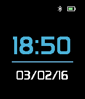
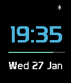

<!-- Generated by scripts/update_app_directory.py: do not edit by hand -->
[← All Pebble Developers](../developers.md)

# NovaG

*3 watchfaces · Last updated 2026-10-12 · [About these lists](../about-app-lists.md)*

Links: [Pebble App Store](https://apps.repebble.com/apps/dev/novag_56a554a6fce0901b0600005d) · [GitHub (NovaGL)](https://github.com/NovaGL) · [Website (mobilenova.wordpress.com)](https://mobilenova.wordpress.com/2016/01/27/pebble-watch-faces/)

<button type="button" data-filter="all" aria-pressed="true">All 3</button><button type="button" data-filter="watchface" aria-pressed="false">Watchfaces 3</button><button type="button" data-filter="watchapp" aria-pressed="false" disabled>Apps 0</button>

<label class="dev-sort">Sort by <select><option value="updated">Recently updated</option><option value="released">Newest release</option><option value="title">A–Z</option></select></label>

<h2 class="app-name" id="app-56b6d683f17b79ba4200006a"><a href="https://apps.repebble.com/56b6d683f17b79ba4200006a">Verticalface</a> v1.4</h2>
<a class="app-source" href="https://github.com/NovaGL/Verticalface" title="Source code" data-search-exclude>View source</a>

Watchface

No licence Released 2016-02-07 Updated 2016-02-14

Runs on: Round 2, Time 2, Pebble 2 Duo, Pebble 2, Time Round, Time, Classic

Simple watch face with vertical hour and minutes. Customize minutes colour and ability to remove leading zero in the settings.

<h2 class="app-name" id="app-56a8370d0b9e95b57f00000a"><a href="https://apps.repebble.com/56a8370d0b9e95b57f00000a">Simpleface</a> v3.1</h2>
<a class="app-source" href="https://github.com/NovaGL/simpleface" title="Source code" data-search-exclude>View source</a>

Watchface

No licence Released 2016-01-27 Updated 2016-02-14

Runs on: Round 2, Time 2, Pebble 2 Duo, Pebble 2, Time Round, Time, Classic

Simple watch face with time and date as well as Pebble Bluetooth and battery status.

<h2 class="app-name" id="app-56a88003124705dd7800001f"><a href="https://apps.repebble.com/56a88003124705dd7800001f">Batteryface</a> v2.20</h2>
<a class="app-source" href="https://github.com/NovaGL/Batteryface" title="Source code" data-search-exclude>View source</a>

Watchface

No licence Released 2016-01-27 Updated 2016-02-14

Runs on: Round 2, Time 2, Pebble 2 Duo, Pebble 2, Time Round, Time, Classic

Simple Pebble watch face with time and date. Features battery bar below time to show current battery level, also contains BT level. Supports multiple languages: English, French, German, Spanish &amp;…

