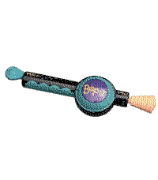
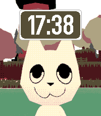
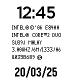

<!-- Generated by scripts/update_app_directory.py: do not edit by hand -->
[← All Pebble Developers](../developers.md)

# nubbybubby

*2 watchfaces and 4 apps · Last updated 2026-10-11 · [About these lists](../about-app-lists.md)*

Links: [Pebble App Store](https://apps.repebble.com/apps/dev/nubbybubby_67a84b8e89529e00099b3a79) · [GitHub (nubbybubby)](https://github.com/nubbybubby)

<button type="button" data-filter="all" aria-pressed="true">All 6</button><button type="button" data-filter="watchface" aria-pressed="false">Watchfaces 2</button><button type="button" data-filter="watchapp" aria-pressed="false">Apps 4</button>

<label class="dev-sort">Sort by <select><option value="updated">Recently updated</option><option value="released">Newest release</option><option value="title">A–Z</option></select></label>

<h2 class="app-name" id="app-69f663b5ea28ba000ab50545"><a href="https://apps.repebble.com/69f663b5ea28ba000ab50545">Chinese Toy Phone</a> v1.4.1</h2>
<a class="app-source" href="https://github.com/nubbybubby/pebble-toy-phone" title="Source code" data-search-exclude>View source</a>

App · <a href="https://forum.rebble.io/t/943" title="Discuss this app on the Rebble forum" data-search-exclude>Forum thread</a>

Released 2026-05-02 Updated 2026-09-19

Runs on: Time 2, Pebble 2 Duo

ay ay ay im your little butterfly ay ay ay im your little butterfly press select to use the phone, and press up/down to change the volume. you can also use the touch screen if you&#x27;re using PT2 lol

<h2 class="app-name" id="app-6a4ad2f55118a30009e22787"><a href="https://apps.repebble.com/6a4ad2f55118a30009e22787">Twist It!</a> v1.0.3</h2>
<a class="app-source" href="https://github.com/nubbybubby/pebble-twist-it" title="Source code" data-search-exclude>View source</a>

App · <a href="https://forum.rebble.io/t/1123" title="Discuss this app on the Rebble forum" data-search-exclude>Forum thread</a>

Released 2026-07-05 Updated 2026-08-20

Runs on: Time 2, Pebble 2 Duo

bop it twist it pull it pull it bop it clone that uses the speaker controls: up: twist (volume up if the game isn&#x27;t active) select: bop down: pull (volume down if the game isn&#x27;t active) touch…

<h2 class="app-name" id="app-67c6beb7d2acb30009a3c809"><a href="https://apps.repebble.com/67c6beb7d2acb30009a3c809">WEBFISHING</a> v1.1</h2>
<a class="app-source" href="https://github.com/nubbybubby/webfishing-watchface" title="Source code" data-search-exclude>View source</a>

Watchface · <a href="https://forum.rebble.io/t/972" title="Discuss this app on the Rebble forum" data-search-exclude>Forum thread</a>

Released 2025-03-04 Updated 2026-05-14

Runs on: Round 2, Time 2, Pebble 2 Duo, Pebble 2, Time Round, Time, Classic

A WEBFISHING themed watchface. (I am not affiliated with lamedeveloper lol)

<h2 class="app-name" id="app-69446bdf105d0c00095aaf51"><a href="https://apps.repebble.com/69446bdf105d0c00095aaf51">mcbroken</a> v1.30</h2>
<a class="app-source" href="https://github.com/nubbybubby/pebble-mcbroken" title="Source code" data-search-exclude>View source</a>

App · <a href="https://forum.rebble.io/t/302" title="Discuss this app on the Rebble forum" data-search-exclude>Forum thread</a>

Released 2025-12-18 Updated 2026-04-15

Runs on: Time 2, Pebble 2 Duo, Pebble 2, Time, Classic

A mcbroken client for Pebble smartwatches. Now you can check if the ice cream machine is down on your wrist! Nearby shows up to 5 McDonald&#x27;s locations within a 5-mile (8.04 km) radius from your…

<h2 class="app-name" id="app-688c29cafc054300094a5d8b"><a href="https://apps.repebble.com/688c29cafc054300094a5d8b">HEARTBEAT animation meme</a> v1.1</h2>
<a class="app-source" href="https://github.com/nubbybubby/pebble-heartbeat-animation-meme/" title="Source code" data-search-exclude>View source</a>

App

Released 2025-08-01 Updated 2025-09-11

Runs on: Round 2, Time 2, Time Round, Time

I ported an animation meme to PT/PTR because I was bored. I know, no one asked for this app to exist lmao. You can toggle the subtitles by pressing select, and the app vibrates to the beat of the…

<h2 class="app-name" id="app-67dcc59b5f4a7200095a2ae1"><a href="https://apps.repebble.com/67dcc59b5f4a7200095a2ae1">Core 2 Duo</a> v1.0</h2>
<a class="app-source" href="https://github.com/nubbybubby/core2duo-watchface/" title="Source code" data-search-exclude>View source</a>

Watchface

Released 2025-03-21 Updated 2025-03-21

Runs on: Round 2, Time 2, Pebble 2 Duo, Pebble 2, Time Round, Time, Classic

experience the core 2 duo watch before release with this very epic watchface

