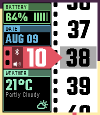
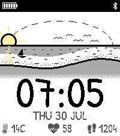
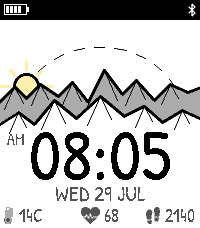
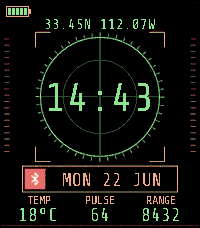
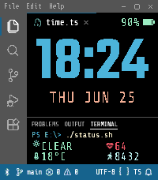
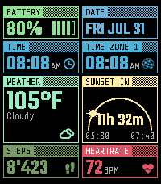

<!-- Generated by scripts/update_app_directory.py: do not edit by hand -->
[← All Pebble Developers](../developers.md)

# Null Syntax

*8 watchfaces · Last updated 2026-10-11 · [About these lists](../about-app-lists.md)*

Links: [Pebble App Store](https://apps.repebble.com/apps/dev/null-syntax_089fa8f469578884846bff5a) · [GitHub (AKlitbo)](https://github.com/AKlitbo) · [Website (andrewklitbo.com)](https://andrewklitbo.com/pebble)

<button type="button" data-filter="all" aria-pressed="true">All 8</button><button type="button" data-filter="watchface" aria-pressed="false">Watchfaces 8</button><button type="button" data-filter="watchapp" aria-pressed="false" disabled>Apps 0</button>

<label class="dev-sort">Sort by <select><option value="updated">Recently updated</option><option value="released">Newest release</option><option value="title">A–Z</option></select></label>

<h2 class="app-name" id="app-c61b74fbb20946fea1ced5ce"><a href="https://apps.repebble.com/c61b74fbb20946fea1ced5ce">Treeline</a> v1.3.2</h2>
<a class="app-source" href="https://github.com/AKlitbo/pebble-watchfaces" title="Source code" data-search-exclude>View source</a>

Watchface

AGPL-3.0 Released 2026-07-31 Updated 2026-09-27

Runs on: Round 2, Time 2

Treeline is a hand-drawn style forest watchface for the Pebble Time 2 and Pebble Round 2. Live weather, wind, the moon phase, a sun that tracks your real sunrise/sunset times, heart rate, steps…

<h2 class="app-name" id="app-f7ab7761bf5e47b98c717f68"><a href="https://apps.repebble.com/f7ab7761bf5e47b98c717f68">Sidereel</a> v1.2.3</h2>
<a class="app-source" href="https://github.com/AKlitbo/pebble-watchfaces" title="Source code" data-search-exclude>View source</a>

Watchface

AGPL-3.0 Released 2026-08-10 Updated 2026-09-27

Runs on: Time 2

Sidereel is a customizable modular watchface for the Pebble Time 2, with a scrolling minute reel and hour pointer beside a dashboard of heart rate, steps, sleep, weather, Quiet Time, Bluetooth…

<h2 class="app-name" id="app-6de09ae5e76b4e698057584f"><a href="https://apps.repebble.com/6de09ae5e76b4e698057584f">Shoreline</a> v1.3.2</h2>
<a class="app-source" href="https://github.com/AKlitbo/pebble-watchfaces" title="Source code" data-search-exclude>View source</a>

Watchface

AGPL-3.0 Released 2026-07-31 Updated 2026-09-27

Runs on: Round 2, Time 2

Shoreline is a hand-drawn style coastal watchface for the Pebble Time 2 and Pebble Round 2. A tide that follows the moon, live weather, the moon phase, a sun that tracks your real sunrise/sunset…

<h2 class="app-name" id="app-ca5c8919370b4a24a4b41c92"><a href="https://apps.repebble.com/ca5c8919370b4a24a4b41c92">Ridgeline</a> v1.4.2</h2>
<a class="app-source" href="https://github.com/AKlitbo/pebble-watchfaces" title="Source code" data-search-exclude>View source</a>

Watchface

AGPL-3.0 Released 2026-07-29 Updated 2026-09-27

Runs on: Round 2, Time 2

Ridgeline is a hand-drawn style mountain watchface for the Pebble Time 2 and Pebble Round 2. Live weather, the moon phase, a sun that tracks your real sunrise/sunset times, heart rate, steps, and…

<h2 class="app-name" id="app-fdd46e97c301494889bc72d2"><a href="https://apps.repebble.com/fdd46e97c301494889bc72d2">Radar Array</a> v1.6.2</h2>
<a class="app-source" href="https://github.com/AKlitbo/pebble-watchfaces" title="Source code" data-search-exclude>View source</a>

Watchface

AGPL-3.0 Released 2026-06-22 Updated 2026-09-27

Runs on: Time 2

Radar Array is a tactical radar-inspired digital watchface for the Pebble Time 2. It shows weather, live GPS coordinates, heart rate, steps, and Bluetooth status, with the hourly vibration…

<h2 class="app-name" id="app-69139dc57a004424b6109c20"><a href="https://apps.repebble.com/69139dc57a004424b6109c20">LCARS Stardate</a> v1.13.0</h2>
<a class="app-source" href="https://github.com/AKlitbo/pebble-watchface-lcars" title="Source code" data-search-exclude>View source</a>

Watchface

Other Released 2026-06-15 Updated 2026-09-27

Runs on: Time 2

LCARS Stardate is a Star Trek inspired LCARS digital watchface for the Pebble Time 2, with a live stardate under the clock. Pick four panels from 26 readouts, including weather, heart rate, steps…

<h2 class="app-name" id="app-620f8b6abe64458caa59fdef"><a href="https://apps.repebble.com/620f8b6abe64458caa59fdef">IDE VSCode</a> v1.5.2</h2>
<a class="app-source" href="https://github.com/AKlitbo/pebble-watchfaces" title="Source code" data-search-exclude>View source</a>

Watchface

AGPL-3.0 Released 2026-06-26 Updated 2026-09-27

Runs on: Time 2

IDE VSCode is a Visual Studio Code-inspired digital watchface for the Pebble Time 2, laid out like a code editor. It shows weather, heart rate, steps, battery, and Bluetooth status, with the…

<h2 class="app-name" id="app-cf60ff6cf2fa45868e4e8a6f"><a href="https://apps.repebble.com/cf60ff6cf2fa45868e4e8a6f">Gridlock</a> v1.5.0</h2>
<a class="app-source" href="https://github.com/AKlitbo/pebble-watchfaces" title="Source code" data-search-exclude>View source</a>

Watchface

AGPL-3.0 Released 2026-06-28 Updated 2026-09-27

Runs on: Time 2

Gridlock is a customizable modular dashboard watchface for the Pebble Time 2, with calendar, weather, stocks, heart rate, steps, sleep, Quiet Time, Bluetooth, battery, moon phase, sunrise/sunset…

