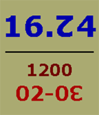

<!-- Generated by scripts/update_app_directory.py: do not edit by hand -->
[← All Pebble Developers](../developers.md)

# Numerist

*1 watchface · Last updated 2026-10-11 · [About these lists](../about-app-lists.md)*

Links: [Pebble App Store](https://apps.repebble.com/apps/dev/numerist_5658ab4ac49ab77a5e00007f) · [GitHub (numerist)](https://github.com/numerist)

<h2 class="app-name" id="app-56bd41f1a4f253c7b600004c"><a href="https://apps.repebble.com/56bd41f1a4f253c7b600004c">Dozenal watch and calendar</a> v1.0</h2>
<a class="app-source" href="http://github.com/numerist/dozclockcal" title="Source code" data-search-exclude>View source</a>

Watchface

No licence Released 2016-02-12 Updated 2016-02-22

Runs on: Round 2, Time 2, Pebble 2 Duo, Pebble 2, Time Round, Time, Classic

This dozenal watch is set up as diurnal, giving the time in the dozenal number base (&quot;base twelve&quot;), dividing the day into successive powers of a dozen. The code includes the four simple changes…

