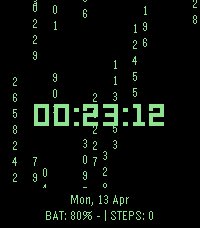
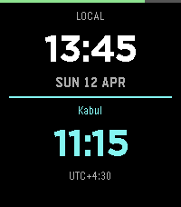
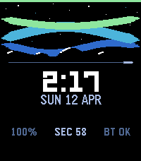

<!-- Generated by scripts/update_app_directory.py: do not edit by hand -->
[← All Pebble Developers](../developers.md)

# nyinyiz

*3 watchfaces · Last updated 2026-10-12 · [About these lists](../about-app-lists.md)*

Links: [Pebble App Store](https://apps.repebble.com/apps/dev/nyinyiz_f5e3748c0c0d40c0ef52a98a) · [GitHub (nyinyiz)](https://github.com/nyinyiz)

<button type="button" data-filter="all" aria-pressed="true">All 3</button><button type="button" data-filter="watchface" aria-pressed="false">Watchfaces 3</button><button type="button" data-filter="watchapp" aria-pressed="false" disabled>Apps 0</button>

<label class="dev-sort">Sort by <select><option value="updated">Recently updated</option><option value="released">Newest release</option><option value="title">A–Z</option></select></label>

<h2 class="app-name" id="app-cb425279b1f849afaf23f476"><a href="https://apps.repebble.com/cb425279b1f849afaf23f476">Matrix</a> v1.3.0</h2>
<a class="app-source" href="https://github.com/nyinyiz/Pebble-watchfaces" title="Source code" data-search-exclude>View source</a>

Watchface

Released 2026-04-12 Updated 2026-08-22

Runs on: Round 2, Time 2, Pebble 2 Duo, Pebble 2, Time Round, Time

Experience the iconic movie&#x27;s visual aesthetic on your wrist with this premium, high-performance Pebble watchface. &quot;Matrix Digital Rain&quot; features a custom-built animation engine that renders…

<h2 class="app-name" id="app-7bd28835304b4ef1b638f44f"><a href="https://apps.repebble.com/7bd28835304b4ef1b638f44f">Dual Time</a> v1.1.0</h2>
<a class="app-source" href="https://github.com/nyinyiz/Pebble-watchfaces" title="Source code" data-search-exclude>View source</a>

Watchface

Released 2026-04-12 Updated 2026-08-22

Runs on: Round 2, Time 2, Pebble 2 Duo, Pebble 2, Time Round, Time, Classic

See two time zones at once. Your local time up top, your chosen city below — separated by a clean glowing line. Hold SELECT to pick from 271 world cities, A to Z. Works without a phone.

<h2 class="app-name" id="app-8703388706394b1981bfebea"><a href="https://apps.repebble.com/8703388706394b1981bfebea">Aurora</a> v2.0.2</h2>
<a class="app-source" href="https://github.com/nyinyiz/Pebble-watchfaces" title="Source code" data-search-exclude>View source</a>

Watchface

Released 2026-04-11 Updated 2026-08-22

Runs on: Round 2, Time 2, Pebble 2 Duo, Pebble 2, Time Round, Time

A premium utility-first watchface with an aurora borealis visual design. Features - Animated aurora bands — three layered sine-wave bands (violet, teal, green) that flow and pulse in real time …

