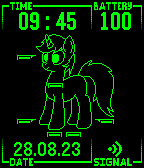

<!-- Generated by scripts/update_app_directory.py: do not edit by hand -->
[← All Pebble Developers](../developers.md)

# nyrikiri

*2 watchfaces · Last updated 2026-10-11 · [About these lists](../about-app-lists.md)*

Links: [Pebble App Store](https://apps.repebble.com/apps/dev/nyrikiri_63121c3a5e45c40008d0bc52) · [GitHub (wirelune)](https://github.com/wirelune) · [Website (derpibooru.org)](https://derpibooru.org/profiles/nyrikiri)

<button type="button" data-filter="all" aria-pressed="true">All 2</button><button type="button" data-filter="watchface" aria-pressed="false">Watchfaces 2</button><button type="button" data-filter="watchapp" aria-pressed="false" disabled>Apps 0</button>

<label class="dev-sort">Sort by <select><option value="updated">Recently updated</option><option value="released">Newest release</option><option value="title">A–Z</option></select></label>

<h2 class="app-name" id="app-64ebc715c8c40c03a8180991"><a href="https://apps.repebble.com/64ebc715c8c40c03a8180991">Fallout:Equestria PipBuck</a> v1.0</h2>
<a class="app-source" href="https://github.com/wirelune/PipBuck" title="Source code" data-search-exclude>View source</a>

Watchface

Released 2023-08-27 Updated 2023-08-27

Runs on: Round 2, Time 2, Pebble 2 Duo, Pebble 2, Time Round, Time, Classic

For all FoE fans, a PipBuck watchface! It displays current time, battery charge, date and connection status. It also features Littlepip, main character of Fallout:Equestria fiction. Her health…

<h2 class="app-name" id="app-64d4fbb3118fcc0569f570ef"><a href="https://apps.repebble.com/64d4fbb3118fcc0569f570ef">Lunatic</a> v1.4</h2>
<a class="app-source" href="https://github.com/wirelune/Lunatic" title="Source code" data-search-exclude>View source</a>

Watchface

Released 2023-08-10 Updated 2023-08-17

Runs on: Round 2, Time 2, Time Round, Time

!!!Highly Experimental! Expect fast battery drain and instability!!! A watchface for Pebble Time featuring Princess Luna, a character from My Little Pony: Friendship is magic. She rests at morning…

