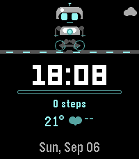

<!-- Generated by scripts/update_app_directory.py: do not edit by hand -->
[← All Pebble Developers](../developers.md)

# oguzy

*1 watchface · Last updated 2026-10-12 · [About these lists](../about-app-lists.md)*

Links: [Pebble App Store](https://apps.repebble.com/apps/dev/oguzy_cd87d6c5246e03b91419d43d) · [GitHub (oguzy)](https://github.com/oguzy)

<h2 class="app-name" id="app-cae23bbd464541c2b5c787f3"><a href="https://apps.repebble.com/cae23bbd464541c2b5c787f3">Robi</a> v1.13.0</h2>
<a class="app-source" href="https://github.com/oguzy/robi" title="Source code" data-search-exclude>View source</a>

Watchface

Released 2026-09-06 Updated 2026-09-08

Runs on: Time 2

Robi is a robot companion that lives on your wrist. It walks and runs along with you, reads a book, works at a laptop, grabs a snack, hops on a bike, wanders around, and sometimes wanders…

