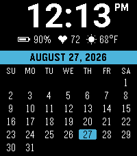

<!-- Generated by scripts/update_app_directory.py: do not edit by hand -->
[← All Pebble Developers](../developers.md)

# OkGoDoIt

*1 watchface · Last updated 2026-10-11 · [About these lists](../about-app-lists.md)*

Links: [Pebble App Store](https://apps.repebble.com/apps/dev/okgodoit_2d457468692a72f27c7bda43) · [GitHub (OkGoDoIt)](https://github.com/OkGoDoIt)

<h2 class="app-name" id="app-865c44435a054e288357979f"><a href="https://apps.repebble.com/865c44435a054e288357979f">MonthGrid Watchface</a> v1.2.0</h2>
<a class="app-source" href="https://github.com/OkGoDoIt/pebble-monthgrid" title="Source code" data-search-exclude>View source</a>

Watchface · <a href="https://forum.rebble.io/t/1303" title="Discuss this app on the Rebble forum" data-search-exclude>Forum thread</a>

No licence Released 2026-08-30 Updated 2026-09-02

Runs on: Round 2, Time 2, Pebble 2 Duo, Pebble 2, Time Round, Time, Classic

A full month calendar watchface with tons of customizability. The time up top, a full month calendar below, and a status line with customizable info. Inspired by the old Calendar Watchface by…

