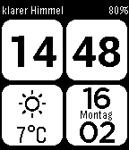

<!-- Generated by scripts/update_app_directory.py: do not edit by hand -->
[← All Pebble Developers](../developers.md)

# oku

*1 watchface · Last updated 2026-10-12 · [About these lists](../about-app-lists.md)*

Links: [Pebble App Store](https://apps.repebble.com/apps/dev/oku_53566b5726172a558a000080) · [GitHub (okukun)](https://github.com/okukun)

<h2 class="app-name" id="app-54e202b1cf66dc54e300008b"><a href="https://apps.repebble.com/54e202b1cf66dc54e300008b">MetroWeather</a> v0.4</h2>
<a class="app-source" href="https://github.com/okukun/MetroWeather" title="Source code" data-search-exclude>View source</a>

Watchface

Released 2015-02-16 Updated 2016-01-27

Runs on: Time 2, Pebble 2 Duo, Pebble 2, Time, Classic

MetroWeather watchface displays time, date and weather information in a nice and clean metro design. Features: - Automatic Localization for English, French, German, Spanish and Chinese. - Degrees…

