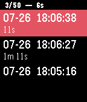

<!-- Generated by scripts/update_app_directory.py: do not edit by hand -->
[← All Pebble Developers](../developers.md)

# Oldschool.de

*1 app · Last updated 2026-10-12 · [About these lists](../about-app-lists.md)*

Links: [Pebble App Store](https://apps.repebble.com/apps/dev/oldschool-de_54353c3c32035c53d80001c5) · [GitHub (robinson2)](https://github.com/robinson2)

<h2 class="app-name" id="app-578265d46c21044cf5000653"><a href="https://apps.repebble.com/578265d46c21044cf5000653">Session Timer</a> v1.4</h2>
<a class="app-source" href="https://github.com/robinson2/PebbleSessionTimer" title="Source code" data-search-exclude>View source</a>

App

Released 2016-07-10 Updated 2016-08-31

Runs on: Round 2, Time 2, Pebble 2 Duo, Pebble 2, Time Round, Time, Classic

Track your surfing or swimming sessions and other activities while your smartphone is out of reach. The app lists and saves up to 50 timestamps with duration of each session (the time between two…

