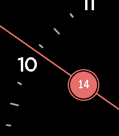
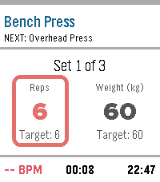

<!-- Generated by scripts/update_app_directory.py: do not edit by hand -->
[← All Pebble Developers](../developers.md)

# oliben10

*1 watchface and 1 app · Last updated 2026-10-11 · [About these lists](../about-app-lists.md)*

Links: [Pebble App Store](https://apps.repebble.com/apps/dev/oliben10_3f84a76582738ea27551ffa7) · [GitHub (oliverano95)](https://github.com/oliverano95)

<button type="button" data-filter="all" aria-pressed="true">All 2</button><button type="button" data-filter="watchface" aria-pressed="false">Watchfaces 1</button><button type="button" data-filter="watchapp" aria-pressed="false">Apps 1</button>

<label class="dev-sort">Sort by <select><option value="updated">Recently updated</option><option value="released">Newest release</option><option value="title">A–Z</option></select></label>

<h2 class="app-name" id="app-f4e0bd13e8b14f2b8728ff22"><a href="https://apps.repebble.com/f4e0bd13e8b14f2b8728ff22">Wyrd Loom</a> v1.3.0</h2>
<a class="app-source" href="https://github.com/oliverano95/WyrdLoom" title="Source code" data-search-exclude>View source</a>

Watchface

Released 2026-04-14 Updated 2026-09-06

Runs on: Round 2, Time 2, Pebble 2 Duo, Pebble 2, Time Round, Time, Classic

Initial release

<h2 class="app-name" id="app-0664a987078943a28f196064"><a href="https://apps.repebble.com/0664a987078943a28f196064">GymTracker</a> v6.16.1</h2>
<a class="app-source" href="https://github.com/oliverano95/GymTracker" title="Source code" data-search-exclude>View source</a>

App · <a href="https://forum.rebble.io/t/931" title="Discuss this app on the Rebble forum" data-search-exclude>Forum thread</a>

Released 2026-04-09 Updated 2026-08-24

Runs on: Round 2, Time 2, Pebble 2 Duo, Pebble 2, Time Round, Time

Leave your phone in your locker. A fully-featured, standalone workout tracker with smart rest timers, haptic coaching, and automatic data export. Transform your Pebble into the ultimate gym…

