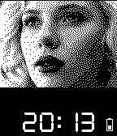
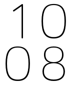

<!-- Generated by scripts/update_app_directory.py: do not edit by hand -->
[← All Pebble Developers](../developers.md)

# Oliver Bowe

*4 watchfaces · Last updated 2026-10-12 · [About these lists](../about-app-lists.md)*

Links: [Pebble App Store](https://apps.repebble.com/apps/dev/oliver-bowe_52cdaf6f0b54dbbe46000001) · [GitHub (thunderchild7)](https://github.com/thunderchild7)

<button type="button" data-filter="all" aria-pressed="true">All 4</button><button type="button" data-filter="watchface" aria-pressed="false">Watchfaces 4</button><button type="button" data-filter="watchapp" aria-pressed="false" disabled>Apps 0</button>

<label class="dev-sort">Sort by <select><option value="updated">Recently updated</option><option value="released">Newest release</option><option value="title">A–Z</option></select></label>

<h2 class="app-name" id="app-53243430dbe04d33770001e8"><a href="https://apps.repebble.com/53243430dbe04d33770001e8">Orbitron D</a> v1.3.6</h2>
<a class="app-source" href="https://github.com/thunderchild7/orbitron-d" title="Source code" data-search-exclude>View source</a>

Watchface

Released 2014-03-15 Updated 2014-07-19

Runs on: Time 2, Pebble 2 Duo, Pebble 2, Time, Classic

A simple digital watch face using the Orbitron font. Includes the day of the week and date. and optional display of seconds. The display can be inverted and can vibrate in 5 minutes intervals up…

<h2 class="app-name" id="app-5348115ae311a6ddb4000076"><a href="https://apps.repebble.com/5348115ae311a6ddb4000076">Scarlett Johansson</a> v1.0.1</h2>
<a class="app-source" href="https://github.com/thunderchild7/ScarJo" title="Source code" data-search-exclude>View source</a>

Watchface

Released 2014-04-11 Updated 2014-04-12

Runs on: Time 2, Pebble 2 Duo, Pebble 2, Time, Classic

Basic Scarlett Johansson watchface, digital time display, a light tap will briefly show the date, and a battery status indicator.

<h2 class="app-name" id="app-530d4af6d4317149ea00008c"><a href="https://apps.repebble.com/530d4af6d4317149ea00008c">Taylor Swift</a> v2.2.3</h2>
<a class="app-source" href="https://github.com/thunderchild7/TaylorSwift" title="Source code" data-search-exclude>View source</a>

Watchface

Released 2014-02-26 Updated 2014-04-03

Runs on: Time 2, Pebble 2 Duo, Pebble 2, Time, Classic

Simple Taylor Swift digital watch face, a sharp tap will briefly show the date.

<h2 class="app-name" id="app-531b45c62a95cc72b0000523"><a href="https://apps.repebble.com/531b45c62a95cc72b0000523">Big Bariol</a> v6.1.5</h2>
<a class="app-source" href="https://github.com/thunderchild7/big_time_bariol" title="Source code" data-search-exclude>View source</a>

Watchface

Released 2014-03-08 Updated 2014-03-27

Runs on: Time 2, Pebble 2 Duo, Pebble 2, Time, Classic

Big Time but with the Bariol font and configurable. Can also vibrate at configurable intervals. kudos to Albert Rojo (@albertrojo) based on the Big Time watch by Pebble Technologies. Using the…

