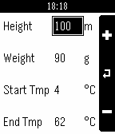

<!-- Generated by scripts/update_app_directory.py: do not edit by hand -->
[← All Pebble Developers](../developers.md)

# Oliver Koeth

*1 app · Last updated 2026-10-12 · [About these lists](../about-app-lists.md)*

Links: [Pebble App Store](https://apps.repebble.com/apps/dev/oliver-koeth_542d52a51d86053a9500018d) · [GitHub (okoeth)](https://github.com/okoeth)

<h2 class="app-name" id="app-5682e73cacdafb8e40000051"><a href="https://apps.repebble.com/5682e73cacdafb8e40000051">Egg Timer</a> v1.1</h2>
<a class="app-source" href="https://github.com/okoeth/eggtimer-pebble" title="Source code" data-search-exclude>View source</a>

App

Released 2015-12-29 Updated 2016-01-04

Runs on: Time 2, Pebble 2 Duo, Pebble 2, Time, Classic

The Egg Timer based on the formula of Charles D.H. Williams is really easy to use. Before you start simply create a new configuration (&quot;New...&quot; in the main menu) which fits your egg and location…

