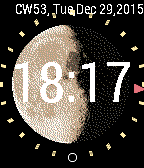

<!-- Generated by scripts/update_app_directory.py: do not edit by hand -->
[← All Pebble Developers](../developers.md)

# Oliver Merkel

*4 watchfaces and 1 app · Last updated 2026-10-12 · [About these lists](../about-app-lists.md)*

Links: [Pebble App Store](https://apps.repebble.com/apps/dev/oliver-merkel_55592fc6b038d44f9e00003e) · [GitHub (OMerkel)](https://github.com/OMerkel)

<button type="button" data-filter="all" aria-pressed="true">All 5</button><button type="button" data-filter="watchface" aria-pressed="false">Watchfaces 4</button><button type="button" data-filter="watchapp" aria-pressed="false">Apps 1</button>

<label class="dev-sort">Sort by <select><option value="updated">Recently updated</option><option value="released">Newest release</option><option value="title">A–Z</option></select></label>

<h2 class="app-name" id="app-558c86d9a2deec56ce00001a"><a href="https://apps.repebble.com/558c86d9a2deec56ce00001a">Moon for Northern Hemisphere</a> v1.3</h2>
<a class="app-source" href="https://github.com/OMerkel/pebble-samples" title="Source code" data-search-exclude>View source</a>

Watchface

MIT Released 2015-06-25 Updated 2016-03-26

Runs on: Time 2, Pebble 2 Duo, Pebble 2, Time, Classic

* Moon for Northern Hemisphere is a watchface derived from Decelerate Northern Hemisphere watchface * Main display is showing the current Moon Phase nearly in full screen * Decelerate your day…

<h2 class="app-name" id="app-5573b7db788211edc60000c2"><a href="https://apps.repebble.com/5573b7db788211edc60000c2">Decelerate - Southern Hemisphere</a> v1.0</h2>
<a class="app-source" href="https://github.com/OMerkel/pebble-samples" title="Source code" data-search-exclude>View source</a>

Watchface

MIT Released 2015-06-07 Updated 2016-03-26

Runs on: Time 2, Pebble 2 Duo, Pebble 2, Time, Classic

Decelerate your day with a less stressful time display. Exact time is shown by analog hour hand only. Additional feature is the display of the current Moon phase. The watchface shows a single hour…

<h2 class="app-name" id="app-555d8cbdc6ea7e6d780000a1"><a href="https://apps.repebble.com/555d8cbdc6ea7e6d780000a1">Decelerate - Northern Hemisphere</a> v1.0</h2>
<a class="app-source" href="https://github.com/OMerkel/pebble-samples" title="Source code" data-search-exclude>View source</a>

Watchface

MIT Released 2015-05-21 Updated 2016-03-26

Runs on: Time 2, Pebble 2 Duo, Pebble 2, Time, Classic

Decelerate your day with a less stressful time display. Exact time is shown by analog hour hand only. Additional feature is the display of the current Moon phase. The watchface shows a single hour…

<h2 class="app-name" id="app-55959120308fd7e738000072"><a href="https://apps.repebble.com/55959120308fd7e738000072">Oh dear! Oh dear! I shall be too late!</a> v1.1</h2>
<a class="app-source" href="https://github.com/OMerkel/pebble-samples" title="Source code" data-search-exclude>View source</a>

Watchface

MIT Released 2015-07-02 Updated 2015-07-08

Runs on: Time 2, Pebble 2 Duo, Pebble 2, Time, Classic

&quot;DOWN THE RABBIT-HOLE. ... when suddenly a white rabbit with pink eyes ran close by her. There was nothing so very remarkable in that; nor did Alice think it so very much out of the way to hear…

<h2 class="app-name" id="app-55594b659655054dcb00006b"><a href="https://apps.repebble.com/55594b659655054dcb00006b">Pebble Fortune</a> v1.0</h2>
<a class="app-source" href="https://github.com/OMerkel/pebble-js-samples" title="Source code" data-search-exclude>View source</a>

App

MIT Released 2015-05-18 Updated 2015-05-18

Runs on: Time 2, Pebble 2 Duo, Pebble 2, Time, Classic

Pebble Fortune Cookies allows to retrieve a fortune text. Its objective is to display the fortune cookie text from AJAX request on a Pebble Watch Window.

