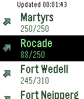

<!-- Generated by scripts/update_app_directory.py: do not edit by hand -->
[← All Pebble Developers](../developers.md)

# Olivier Gérardin

*1 app · Last updated 2026-10-12 · [About these lists](../about-app-lists.md)*

Links: [Pebble App Store](https://apps.repebble.com/apps/dev/olivier-g-rardin_56700e12057ecdc54700001f) · [GitHub (ogerardin)](https://github.com/ogerardin)

<h2 class="app-name" id="app-568d42568cd1f8e2a5000072"><a href="https://apps.repebble.com/568d42568cd1f8e2a5000072">LuxParking</a> v0.3</h2>
<a class="app-source" href="https://github.com/ogerardin/LuxParking" title="Source code" data-search-exclude>View source</a>

App

Released 2016-01-06 Updated 2016-01-28

Runs on: Round 2, Time 2, Pebble 2 Duo, Pebble 2, Time Round, Time, Classic

A Pebble watchapp for displaying parking occupancy in Luxembourg city using the RSS feed provided by Ville de Luxembourg. The first screen shows a list of city areas. If you select an area, you…

