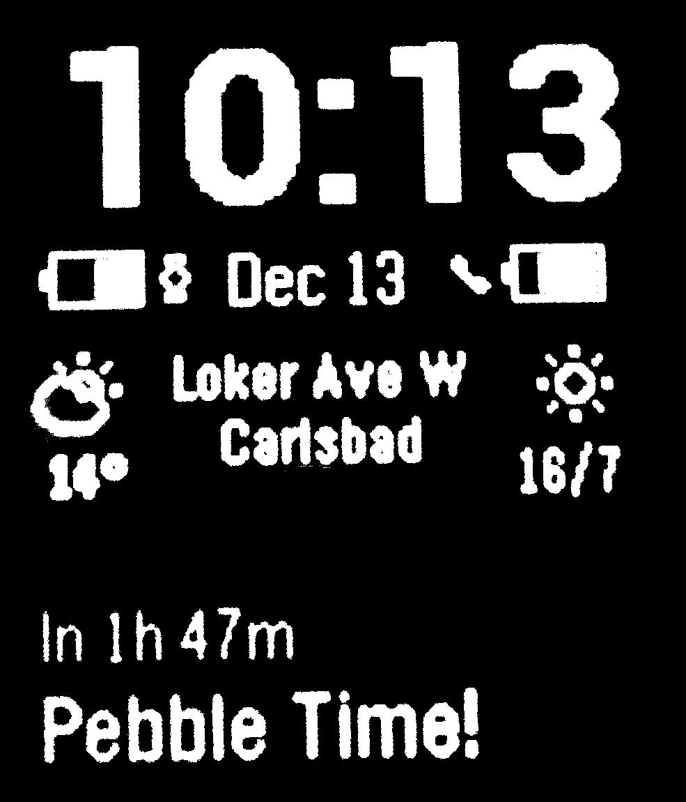

<!-- Generated by scripts/update_app_directory.py: do not edit by hand -->
[← All Pebble Developers](../developers.md)

# Olivier Pasco

*1 app · Last updated 2026-10-11 · [About these lists](../about-app-lists.md)*

Links: [Pebble App Store](https://apps.repebble.com/apps/dev/olivier-pasco_52ab4b9cb8f6c2b68400001e) · [GitHub (opasco)](https://github.com/opasco)

<h2 class="app-name" id="app-52cded255c88b9059700000e"><a href="https://apps.repebble.com/52cded255c88b9059700000e">SmartStatus-op</a> v1.01</h2>
<a class="app-source" href="https://github.com/opasco/SmartStatus-op" title="Source code" data-search-exclude>View source</a>

App

Released 2014-01-09 Updated 2014-06-27

Runs on: Time 2, Pebble 2 Duo, Pebble 2, Time, Classic

This is a modified version of the SmartStatus watch app by Robert Hesse. It only works in conjunction with the Smartwatch+ iOS app available on the Apple App Store…

