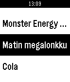

<!-- Generated by scripts/update_app_directory.py: do not edit by hand -->
[← All Pebble Developers](../developers.md)

# Olli Salli

*1 app · Last updated 2026-10-11 · [About these lists](../about-app-lists.md)*

Links: [Pebble App Store](https://apps.repebble.com/apps/dev/olli-salli_531dab70901dc724ae000178) · [GitHub (ollisal)](https://github.com/ollisal) · [Website (drunkards.duckdns.org)](http://drunkards.duckdns.org)

<h2 class="app-name" id="app-565ada8acb722e1d6e000043"><a href="https://apps.repebble.com/565ada8acb722e1d6e000043">Tiny Drunkard</a> v1.0</h2>
<a class="app-source" href="http://github.com/ollisal/tiny-drunkard" title="Source code" data-search-exclude>View source</a>

App

No licence Released 2015-11-29 Updated 2015-11-29

Runs on: Time 2, Pebble 2 Duo, Pebble 2, Time, Classic

Client for drunkards.duckdns.org

