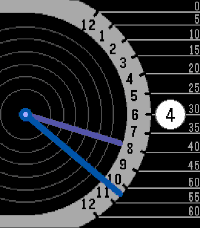

<!-- Generated by scripts/update_app_directory.py: do not edit by hand -->
[← All Pebble Developers](../developers.md)

# ollien

*2 watchfaces · Last updated 2026-10-11 · [About these lists](../about-app-lists.md)*

Links: [Pebble App Store](https://apps.repebble.com/apps/dev/ollien_ccb9291cdf771299703aa2ae) · [GitHub (ollien)](https://github.com/ollien)

<button type="button" data-filter="all" aria-pressed="true">All 2</button><button type="button" data-filter="watchface" aria-pressed="false">Watchfaces 2</button><button type="button" data-filter="watchapp" aria-pressed="false" disabled>Apps 0</button>

<label class="dev-sort">Sort by <select><option value="updated">Recently updated</option><option value="released">Newest release</option><option value="title">A–Z</option></select></label>

<h2 class="app-name" id="app-836fe574006048dd84dacb5d"><a href="https://apps.repebble.com/836fe574006048dd84dacb5d">Faceoff</a> v1.3</h2>
<a class="app-source" href="https://github.com/ollien/pebble-faceoff" title="Source code" data-search-exclude>View source</a>

Watchface

Released 2026-05-25 Updated 2026-05-26

Runs on: Round 2, Time 2, Time Round, Time

A Pebble watchface inspired by &quot;versus&quot; screens.

<h2 class="app-name" id="app-968b7e2ad0a4495ba4b0f50f"><a href="https://apps.repebble.com/968b7e2ad0a4495ba4b0f50f">Retrograde</a> v1.3</h2>
<a class="app-source" href="https://github.com/ollien/pebble-retrograde" title="Source code" data-search-exclude>View source</a>

Watchface

Released 2026-04-05 Updated 2026-05-25

Runs on: Time 2

Watchface heavily inspired by the Xeric Timeline Retrograde

